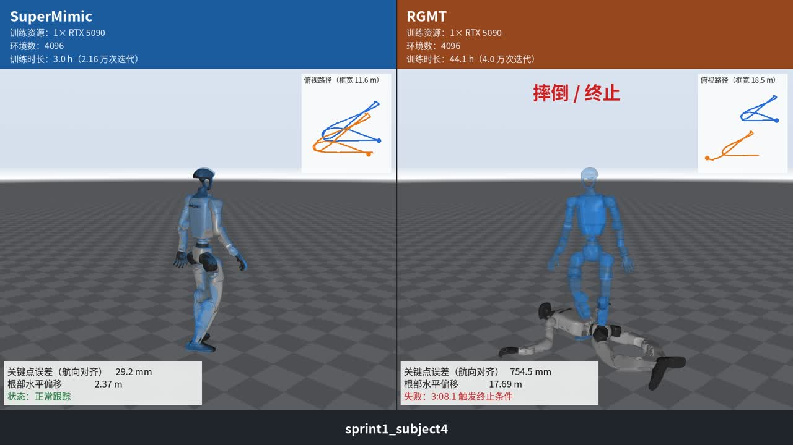

# SuperMimic-Reproduced

从零复现 SuperMimic：用一个学习得到的可微世界模型，通过短视野 BPTT 训练 Unitree G1（29 自由度）的全身动作跟踪策略。仿真底座为 mjlab（MuJoCo Warp），世界模型、想象训练器、多 clip 动作库、基于回报的重置采样、评测全部自行实现，不依赖 rsl_rl。

[](https://www.bilibili.com/video/BV1ZGnt68EEZ/?spm_id_from=333.1365.top_right_bar_window_history.content.click&vd_source=0cf6dfba952d78da546c124a068c21e0)

*点击图片观看 SuperMimic 与 RGMT 的对比视频（2:24，详见[第 7 节](#7-与-rgmt-的对比视频)）。*

## 1. 复现的论文

**SuperMimic: Scaling Humanoid Whole-Body Control with One Differentiable World Model**
Q. Liao, Y. Shao, J. Long, K. Zakka, R. Horowitz, P. Abbeel, K. Sreenath（UC Berkeley），CoRL 2026，[arXiv:2610.28480](https://arxiv.org/abs/2610.28480)，项目页 https://supermimic.github.io（论文发布时代码未公开）。

## 2. 参考的仓库与数据

| 名称 | 用途 |
|---|---|
| supermimic_vibed（Chong Zhang，ETH Zurich，MIT 许可） | 另一份基于 Isaac Lab 3 的 SuperMimic 复现 |
| SuperMimic-Reproduced | 该项目的baseline |


## 3. 环境安装

要求：Linux、NVIDIA GPU、[uv](https://docs.astral.sh/uv/)、Python 3.12。锁文件中的版本为 torch 2.14.1+cu130、mujoco / mujoco-warp 3.16、warp-lang 1.18，需要 **NVIDIA 驱动 ≥ 580**。

```bash
git clone <this repo> SuperMimic-Reproduced && cd SuperMimic-Reproduced
uv sync --group dev
env -u PYTHONPATH uv run pytest tests -q          # 37 项测试（需要 GPU 和 LAFAN1 npz 的测试会自动跳过）
```

**驱动低于 580（例如 570 / CUDA 12.8）时**：torch 2.14 没有 cu128/cu129 版本，cu126 版本又不含 RTX 50 系的 sm_120 内核，因此在 venv 里换成 CUDA 12 构建，并在每次使用前加载一个环境脚本：

```bash
uv sync --group dev
uv pip install --python .venv/bin/python "torch==2.13.0+cu129" \
    --index-url https://download.pytorch.org/whl/cu129 --extra-index-url https://pypi.org/simple --index-strategy unsafe-best-match
uv pip install --python .venv/bin/python --no-deps \
    https://github.com/NVIDIA/warp/releases/download/v1.18.0/warp_lang-1.18.0+cu12-py3-none-manylinux_2_28_x86_64.whl
source scripts/env_cuda12_driver.sh   # 每个新 shell 都要执行
uv run pytest tests -q
```

`scripts/env_cuda12_driver.sh` 做三件事：
- 设置 `UV_NO_SYNC=1`，否则 `uv run` 会把 venv 还原成 cu130 版本；
- 让 Triton 编译 Blackwell 内核时改用 CUDA 12.8 的 ptxas（CUDA 13 的 ptxas 生成的 cubin 在 12.x 驱动上报 "device kernel image is invalid"）；
- 设置 `NCCL_CUMEM_ENABLE=0`：多卡时每个进程只看到一张卡，而 RTX 5090 之间不支持 peer access。

系统 `PYTHONPATH` 若带有其他 Python 版本的包（如 ROS），所有命令前加 `env -u PYTHONPATH`。

**数据（LAFAN1）**：

```bash
uvx --from huggingface_hub hf download lvhaidong/LAFAN1_Retargeting_Dataset --repo-type dataset \
    --include "g1/*" --local-dir data/raw/lafan1
uv run python scripts/data/csv_to_npz_batch.py --input-dir data/raw/lafan1/g1 --output-dir data/npz/lafan1 \
    --input-fps 30 --workers 16                       # 40 条，2.451 h，约 5 s
```

BONES-SEED 的转换、过滤、打包见 `scripts/data/filter_bones_seed.py`、`scripts/data/build_library.py`（`--help`）。`data/` 与 `logs/` 不入库。

## 4. 与论文的主要区别

1. **策略目标中加入了参考相对朝向（6 维）。** 论文 Table A.1 的本体观测只有 93 维，g_t 只写了"K=10 未来参考帧"，没有说明是否包含参考与机器人之间的相对量。按字面实现（纯参考目标，`--env.anchor-obs none`）时，策略无法纠正航向漂移，评测回报停在约 0.56。现在默认在目标中加入"参考躯干相对机器人躯干的朝向"（同 mjlab 无状态估计跟踪任务的 `motion_anchor_ori_b`，只需 IMU，不需要状态估计），回报提高到 0.80 以上。
2. **采纳了 supermimic_vibed 的若干训练做法**（论文均未提及）：
   - 世界模型与策略输入的滑动均值方差归一化；世界模型加 LayerNorm；
   - 解析的软终止头；策略激活用 ELU；
   - 前 500 次迭代只训练世界模型；想象起点距 clip 末尾至少 32 帧；
   - 默认关闭自碰撞；执行用的带噪动作截断到 ±20；
   - 奖励、终止、critic 特征移出想象循环批量计算（数值等价，提速 2.5 倍）。

   消融表明，策略输入归一化和关闭自碰撞主要加快前期学习；世界模型的归一化和 LayerNorm 没有可测影响。
3. **critic 额外输入特权跟踪误差**（根部误差、锚点相对位姿、14 个刚体位置误差、关节误差，共 84 维）。它们都是 ŝ 与参考动作的函数，不超出论文 V(ŝ, g, ξ) 的信息范围；去掉后结果在噪声内。
4. **数值精度默认 bf16**（论文为 TF32）。只作用于网络的矩阵乘法，状态积分、正运动学、奖励仍为 fp32；本机实测快 31%。`--amp none` 可改回 TF32。第 6 节的训练结果是在 TF32 下得到的。
5. **硬件不同**：RTX 5090 + Xeon Gold 6530 宿主（单核约 2.7 GHz），论文为 H100。训练有一部分受 CPU 发 kernel 的速度限制，墙钟时间不能与论文直接对比。按迭代数衡量，约 1.2 万次迭代达到 0.82，与 supermimic_vibed 一致。
6. **未实现**：速度指令接口与蒸馏对照（附录 B、G）、PPO-Sim / PPO-WM 基线、H 与 critic 的消融、真机部署。

## 5. 论文未写明、按推断实现的部分

论文未指明的事项整理在 [docs/PAPER_SPEC.md](docs/PAPER_SPEC.md) 的 U1–U20，对应的设计决定在 [docs/REPRODUCTION_PLAN.md](docs/REPRODUCTION_PLAN.md) 的 D1–D20，之后的修改在 [docs/IMPROVEMENT_PLAN.md](docs/IMPROVEMENT_PLAN.md)。主要几项：

| 论文未写明的内容 | 本项目的做法 | 依据 |
|---|---|---|
| 世界模型的状态表示与输出 | 状态 = MuJoCo 的 qpos/qvel（71 维），输入去掉航向；输出速度增量，再按"位置 + 时间步 × 新速度"显式积分（零输出 = 匀速外推） | 物理先验，位置与速度天然一致 |
| 状态误差如何归一化 | 按固定名义尺度（根位置 0.05 m、关节速度 2 rad/s 等）归一化后平方求和 | Fig. 3c："normalized by a predefined nominal error" |
| 目标每帧的内容 | 每帧 77 维：关节位置与速度，参考根部的投影重力、角速度、线速度、高度，加相对当前目标帧的位移与旋转 6D；从下一步要达到的帧起取 10 帧 | 只含参考量，保持平移/旋转不变 |
| 相对朝向放在哪 | 放在目标里（运动编码器输入），以躯干为锚点 | 附录 B 中解码器由所有接口共享，速度接口没有参考动作，所以参考相关的量只能放在目标里 |
| 动作噪声是否进入观测 | 只加在执行动作上；观测里的上一步动作和动作变化率惩罚用干净动作 | §3.1："噪声只服务于模型拟合" |
| "迭代"的含义 | 1 次迭代 = 2.5 个仿真步 + 1 次世界模型更新 + 1 次策略更新；学习率在 25 万次迭代内余弦衰减 | Algorithm A.1："ω 和 θ 每次迭代都更新" |
| 重置采样的细节 | 每一步的折扣回报记入所在的 1 s 箱，EMA 更新；超时截断时丢掉最后 100 步；箱内均匀取起点 | 论文只给出 50/40/10 混合与 softmax 温度 |
| 回合与 clip 末尾 | 训练回合最长 10 s，clip 结束视为超时；重置噪声沿用 mjlab 默认 | BeyondMimic / mjlab 惯例 |
| 奖励与终止的参照刚体 | 奖励中的根部项以躯干为锚点（BeyondMimic），终止以骨盆为准（论文原文） | 两处分别沿用各自来源 |
| 域随机化的采样时机 | 脚底摩擦与关节标定偏移每回合重采样，躯干质心启动时采样一次 | 论文称"per-episode sim context" |
| critic 输入、网络激活与初始化 | critic 输入见第 4 节；世界模型最后一层零初始化，策略最后一层增益 0.01 | 常用稳妥选择 |

## 6. 训练时长与效果（LAFAN1，40 条 clip）

**评测协议**同论文附录 F：
- 每条 clip 从首帧整条确定性播放，无观测噪声、无域随机化，摩擦 1.0；
- **归一化回报** = Σ 每步奖励 /（0.1 × 整条 clip 的步数），中途失败的 clip 剩余部分记 0；
- **失败** = 触发训练终止条件（骨盆高度偏差 > 0.25 m 或倾斜偏差 > 0.8）；
- 每 4000 次迭代存一个检查点并评测。

| 配置 | 硬件 | 环境数 | 速度 | 首次 ≥ 0.82 | 3 h 终点 | 失败 |
|---|---|---|---|---|---|---|
| 单卡，打开自碰撞 | 1×RTX 5090 | 4096 | 2.03 it/s | 2.15 h（0.829） | 0.850 | 0/40 |
| **双卡，打开自碰撞** | 2×RTX 5090 | 2×4096 | 每卡 1.98 it/s | **1.66 h（0.848，0 失败）**；1.09 h 时为 0.801 | **0.852** | **0/40** |
| supermimic_vibed | 1×RTX PRO 6000 | 4096 | 3.1 it/s（bf16） | 1.24 h（0.824） | 1.47 h 时为 0.829 | 0/40 |

- **训练量与精度**：3 h 约等于 2.2 万次迭代。上表中本项目的结果都是在 TF32 下得到的；现在默认的 bf16 实测速度为 2.68 it/s，同样迭代数预计可缩短约 25% 的时间，但尚未用完整的 3 h 多种子训练验证。
- **双卡设置**：每张卡各自 4096 个环境和回放缓冲，梯度和归一化统计量做 all-reduce，学习率 ×√2（论文的双卡设置）。按墙钟时间更早达到 0.82，3 h 终点与单卡相当。
- **单个检查点的评测分数波动较大**：例如一个种子在第 16000 次迭代掉到 0.721、9/40 失败，前后检查点都在 0.82 以上。原因是整条 clip（平均约 220 s）的确定性评测对一次摔倒非常敏感，建议评测多个检查点再挑选。
- **纯参考目标的对照**：不含相对朝向（`--env.anchor-obs none`），同样训练 3 h 只有 0.564、5/40 失败。
- 完整的实验记录、消融与历史结果见 [docs/EXPERIMENTS.md](docs/EXPERIMENTS.md)；其中 v1 的 e2–e8 使用旧评测口径，数字偏高。

## 7. 与 RGMT 的对比视频

[](docs/media/supermimic_vs_rgmt_g1.mp4)

[`docs/media/supermimic_vs_rgmt_g1.mp4`](docs/media/supermimic_vs_rgmt_g1.mp4)（2:24，720p；1080p 原版由 `scripts/render_compare.py` 生成）。

- 左：SuperMimic，第 6 节的双卡模型（3 h 终点）；右：RGMT，rgmt_mjlab 的最新模型 `stage1_v4_smooth / model_39999`。
- 两侧使用同一个 G1 模型、同样的相机和叠加样式。半透明蓝色为参考动作，已对齐到机器人的水平位置与朝向。
- 画面中的关键点误差、根部水平偏移和失败判定，两侧用同一套公式计算。

| 片段 | clip 内时间 | 关键点误差 SuperMimic / RGMT | 失败 |
|---|---|---|---|
| dance2_subject1 | 0–36 s | 25.4 / 31.2 mm | 均无 |
| fallAndGetUp1_subject1 | 84.7–120.7 s | 82.1 / 154.4 mm | 均无 |
| sprint1_subject4 | 162–198 s | 31.4 / 238.6 mm | RGMT 在 188 s 摔倒 |
| walk3_subject4 | 170–206 s | 114.5 / 55.5 mm（RGMT 明显更好） | 均无 |

## 8. 训练与评测命令

```bash
# 单卡（默认配置）；上真机前建议加 --env.self-collision
uv run sm-train --run-name lafan1 --data.npz-dir data/npz/lafan1 \
    --env.num-envs 4096 --policy-trainer.batch-size 4096 --schedule.max-hours 3

# 双卡数据并行（CUDA_VISIBLE_DEVICES 中的卡按 LOCAL_RANK 分配给各进程）
CUDA_VISIBLE_DEVICES=1,2 uv run torchrun --nproc_per_node 2 -m supermimic.scripts.train --run-name lafan1-2gpu \
    --data.npz-dir data/npz/lafan1 --env.num-envs 4096 --policy-trainer.batch-size 4096 --env.self-collision --schedule.max-hours 3
```

超参默认值按论文 Table A.5：4096 环境、H=32、UTD 0.4、γ=0.99、GAE λ=0.95、Adam 2e-4；世界模型每次 10 批 × 2048 个 8 步窗口；策略批 4096；critic 5 epoch × 4 minibatch。日志为 TensorBoard（`logs/<run>/tb`），每 4000 次迭代存检查点。

## 9. 代码结构

```
src/supermimic/
  config.py                训练配置（tyro 命令行）
  goal_spec.py             目标布局（相对朝向模式、每帧特征维度）
  data/                    CSV/BVH → 50 Hz npz 转换、回放缓冲、仿真数据记录器
  envs/                    mjlab 环境：多 clip 动作命令与回报重置采样、带噪动作项、状态读写、sim context ξ
  kinematics/              G1 可微位置/速度正运动学（与 MuJoCo 对拍到 1e-10），短链正运动学
  world_model/             状态表示、动力学 MLP、解析奖励/观测/终止头、世界模型训练
  imagination/             想象 rollout（逐步策略 + 世界模型，批量奖励/终止/critic 特征）、Eq. 2/3、策略与 critic 训练
  policy/                  运动编码器 + 共享解码器、critic
  training/                训练循环（Algorithm A.1）、学习率调度、数据并行
  eval/                    附录 F 评测
scripts/                   数据转换、评测、回放、吞吐基准、对比视频、实验启动脚本、本机环境脚本
tests/                     正运动学、解析头、环境、世界模型、想象、数据转换、带噪动作等 37 项测试
docs/                      PAPER_SPEC / REPRODUCTION_PLAN / REVIEW_LOG / IMPROVEMENT_PLAN / EXPERIMENTS；media/ 为对比视频
```

## 10. 许可与致谢

代码以 [MIT](LICENSE) 许可发布。方法来自 Liao et al.（CoRL 2026），本项目为独立复现，与原作者无关。mjlab（Apache-2.0）、MuJoCo / MuJoCo Warp（Apache-2.0）原样使用。LAFAN1 动作数据（Ubisoft La Forge，CC BY-NC-ND 4.0）与 BONES-SEED 不随仓库分发，对比视频中的参考动作仅作演示。感谢 supermimic_vibed（Chong Zhang）和SuperMimic-Reproduced 提供的参照实现。
